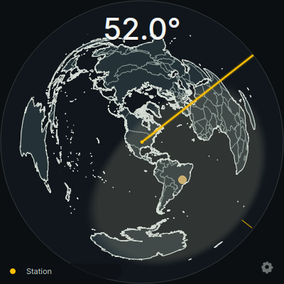

# Meridian

Meridian is a small, fast rotator controller for the Green Heron RT-21 (Traditional and Deluxe / RT-21D, which speak the same protocol). It is aimed at one job: show where the antenna is pointed, and turn it.

The window is the azimuthal map. The heading is a number over the globe. Click the number to type a heading, or click the map to turn to that bearing. Esc or Space stops the rotor. A gear in the corner opens settings. Nothing else sits on the map.

Written for Andrew, K5PO. Licensed under GPL-3.0-or-later. Meridian is designed and tested with RT-21 firmware 4.13.2, the current public release ([download](https://www.greenheronengineering.com/rotator-controllers-software/)). 4.14 is a pre-release. On 4.14.g1 the screen saver and register writes hang serial. Setup locks writes unless a read reports 4.13.2, and says so when it sees 4.14.

On 4.13.2 the rotor's screen saver blanks the panel and serial keeps answering. Polls do not count as activity, and a turn command wakes the display. On 4.14.g1 a 1-minute saver stops serial until a power cycle. OLED units should run 4.13.2. The screen-saver control is shown and is not written.

On firmware 4.13.2, Setup can write each confirmed register from its own Write button. The command is `W` plus the letter, digit `0`, the value, and `;` (`WO010;` for brightness 10). Meridian waits for an idle poll and five seconds with no AT traffic, waits for the ack `06` plus the letter plus `;`, pauses 150 ms, reads `R` plus the letter plus `;`, then watches heading polls for 10 seconds. The status line says `Saved <setting>` or `Write not confirmed: <setting>`. There are no pop-ups. 4.14 stays locked. Brightness has no visible effect on OLED RT-21 units (LCD units only, unverified).

Network settings (DHCP, static IP, mask, gateway, HTTP port, UDP port, and the serial TCP port) can be read or written only over USB or serial. On an IP-only link they are greyed out: "Needs a USB or serial connection; changing network settings over IP can drop the link." A serial read follows the bytes captured from Setup Utility 4.B12: about 3 seconds of answered polls (`BI1;`, `R01;`, `R21;`), then `AT;` answered by `<uart2>;`, then `AT*SERIAL_ECHO=0` plus a line feed about 730 ms after that reply, then `AT*KEY?` plus a line feed, then ESC. No `T11;` and no `T01;`. DTR drops about 520 ms after `<uart2>;` and stays low for 195 ms. The echo is sent as soon as DTR rises. The first try toggles DTR and RTS on the open handle. Later tries rotate through DTR-only and a raw reopen. A success is saved as `net_cycle_mode` in meridian.ini and is tried first next time. On 4.13.2 the module often stays silent, so Meridian repeats that whole cycle up to 12 times, with at least 5 seconds of answered polls between tries, and stops when the echo answers. The status line says `Reading network (try n of 8)…`, then either `Network module answered. Nothing was written.` or `Network module didn't answer after 8 tries`. Write stays off until a read has succeeded on this connection, and a write is checked by reading the value back with the same retry. Nothing pre-fills an address or a port.

Tested with RT-21 firmware 4.13.2 and display firmware 3.1. On 4.13.2 the screen saver is safe over serial and over IP: it blanks the panel and replies keep coming. On 4.14.g1 the saver and register writes hang serial until a power cycle. Users report 4.13.2 feels snappier. That has not been measured.

The Network page keeps this line visible: "Network settings can only be read or changed while connected by USB or serial." On an IP-only link it is normal text and the network fields and buttons are grey. On USB or serial the same line stays, in a quieter color.

The 0.1.0-alpha21 build records raw rotor traffic in `%APPDATA%\Meridian\logs` by default (a `Record rotor traffic` checkbox turns that off). Each log line is flushed immediately. Min speed, rotor type, mode, security, the advanced bitfield, the limit switch, magnetic variation, and the multiplier stay locked because their encodings are not confirmed.

Every TCP connect is limited to 3 seconds. If the rotor closed the session or stopped answering, the next background try waits 20 seconds, then backs off up to 5 minutes. If the host does not answer, tries are 15 seconds apart for the first 2 minutes, then use that same backoff. A click, a typed heading, opening the app, or leaving settings tries immediately. A goto is never resent on a later reconnect. Idle polls are every 30 seconds (30–60 in Settings). Settings has one map switch, **Show sun & day/night**, on by default. The sun and the day/night tint are not clickable. See [docs/ROADMAP.md](docs/ROADMAP.md) for what comes after this alpha.


| Tiny | Medium | Editing a heading |
| --- | --- | --- |
|  |  |  |

The 180 px window drops country borders and labels, thickens the beam, and hides the gear until the pointer is over the window. Larger windows use the 1:50m Natural Earth set, with borders and the names of the larger countries. Lines are drawn in device-independent pixels, so a Retina or 5K display gets a sharp stroke instead of a scaled-up picture. [`docs/screenshots/main-2x.png`](docs/screenshots/main-2x.png) is a 760×760 window rendered at 2× (1520×1520 pixels).

## Build

Qt 6 (Widgets, Network, SerialPort, Svg), a C++17 compiler, and CMake 3.16+.

```bash
cmake -S . -B build -DCMAKE_BUILD_TYPE=Release
cmake --build build --parallel
ctest --test-dir build --output-on-failure
./build/meridian
```

Ubuntu packages: `qt6-base-dev`, `qt6-serialport-dev`, `qt6-svg-dev`, `cmake`, `ninja-build`, `g++`.

On Windows, install Qt 6 with MinGW or MSVC and add its `bin` directory to `PATH` before configuring. On macOS, the Qt online installer or `brew install qt` both work; pass `-DCMAKE_PREFIX_PATH` to the Qt prefix if CMake does not find it. A tag `v*` builds a Windows zip and installer and a macOS `.dmg` in GitHub Actions. Those artifacts are unsigned.

Linux is a first-class build. The release workflows only package Windows and macOS.

## Use

On first launch the home location is grid **EM26** (Bella Vista, Arkansas) and the rotor is not connected yet. The status line says **Set up your RT-21 in settings**. The station rotor is on an Edgeport/8 serial port (COM1 at 4800). Find RT-21 probes every present COM port, Edgeport ports included, at 4800, then 9600, then 19200, and keeps a port only when `BI1;` parses. Setup is one tall column of the same groups as the Green Heron utility. Network settings are read over that serial link with retries; the raw bytes are in `logs/` next to the program. A gateway that is not on the address subnet is called out. The web password is never shown.

In Settings, **Find RT-21** checks USB and COM ports first (4800, then 9600, then 19200). FTDI ports (older units; serial numbers under 2000 need Green Heron's INF, and 2000 and up use the Windows Update FTDI driver) and CP210x ports (units shipped from November 2022, including this station) are probed the same way. A chip with no COM port is only called a possible RT-21, with the driver page for that chip. A USB device that failed its descriptor request is not called an RT-21. If nothing answers on USB or a COM port, Find says so and scans the computer's local IPv4 subnets for TCP 6555 only. A hit is listed only after `BI1;` and `R11;` both answer. No AT command is sent. The result is a button; the address is saved only when that button is clicked. If the scan finds nothing, the status line says **No RT-21 found.** COM ports in the dropdown and under **Serial ports on this computer** are listed COM1, COM2, COM10, not in Windows' enumeration order. Mac device names sort the same way. **Read network** stays off while the live link is IP only, because `T11` drops TCP mode. Manual entry stays underneath. A rotor you already saved is left as it was. `meridian.ini`, `logs/`, and `backups/` sit next to `meridian.exe` (or inside the `.app` only when that folder can be written). If the program folder is read-only, they fall back to `%APPDATA%\Meridian` on Windows and `~/Library/Application Support/Meridian` on macOS. Settings shows the file in use. An older registry entry from alpha1–3 is copied into that file once.

- Click the globe to turn to that bearing. The orange line is where the rotor is now. A short tick on the rim is the heading it is moving toward.
- Click the heading number. Enter, or clicking elsewhere, sends it. Esc cancels the edit.
- Esc or Space, while not editing, sends `;` and stops the rotor.
- The gear opens settings. On a tiny window it stays hidden until the pointer is over the map. Ctrl+, opens settings too.
- A rotor menu appears only when more than one rotor is saved.
- The dot is the link: green connected, amber moving or connecting, red failed. The tooltip has the reason, including a refused TCP connection.

The home location accepts any of:

- Maidenhead, 4, 6, or 8 characters (`EM26`, `EM26UL`)
- A US ZIP or ZIP+4. Centroids come from the Census Bureau 2020 ZCTA gazetteer. ZCTAs leave out some PO-box-only codes.
- Coordinates: `36.47, -94.23`, `36.47N 94.23W`, `N36.47 W94.23`, `36°28'12"N 94°13'48"W`, `36 28 12 N 94 13 48 W`, `36°28.2'N 94°13.8'W`

The resolved latitude, longitude, and grid are shown under the field before you save.

Each rotor is an RT-21 on TCP (`host` and port) or on a serial / USB-serial port. The port list refreshes while the dialog is open. Baud is 4800 by default, or 9600. The frame is 8N1.

### Without a rotor

```bash
./build/meridian-mock --tcp 6555 --heading 52 --speed 20
./build/meridian --connect tcp://127.0.0.1:6555
```

`meridian --mock` starts that mock itself and points the session at it, without rewriting saved settings. `meridian-mock --pty` also prints a pseudo-terminal path on Linux and macOS.

### Controller setup

The Controller tab reads the documented queries (`R11;`, `R01;`, `R41;`, and `RA1;` through `RZ1;`) and can write the numeric EEPROM fields from Appendix F. Apply writes a JSON backup first and asks before sending. Factory reset and the bootloader are not sent. Network settings are read and written only over USB or serial, as described above. The on-wire shape of an EEPROM write is documented in [docs/RT21_PROTOCOL.md](docs/RT21_PROTOCOL.md).


## Tests

`tst_core` covers grids, every coordinate form above, ZIP centroids, click bearing, the 359.9° clamp, the azimuthal projection, country hit-testing, and protocol framing. `tst_driver` connects to the mock over TCP and, on Unix, over a pty, and checks that a second TCP client is refused. `tst_globe` clicks the map and edits the heading.

## Credits

- Click-to-bearing and the Maidenhead conversion are derived from [QLog](https://github.com/foldynl/QLog) `ui/RotatorWidget` and `data/Gridsquare` (GPL-3.0-or-later). Copyright Thomas Gatzweiler 2020 and Ladislav Foldyna 2021–2026. Meridian does not use QLog’s logger, profiles, or database.
- Coastlines and country borders are [Natural Earth](https://www.naturalearthdata.com/) 1:110m and 1:50m land and admin-0 countries, public domain.
- ZIP centroids are the [US Census Bureau 2020 Gazetteer](https://www2.census.gov/geo/docs/maps-data/data/gazetteer/2020_Gazetteer/2020_Gaz_zcta_national.zip) ZCTA file, public domain.
- Inter is © The Inter Project Authors, SIL Open Font License 1.1. See `third_party/inter/OFL.txt`.
- RT-21 behavior follows the Green Heron RT-21 manual (Appendix F) and the Version 4 addendum, plus the Hamlib RT-21 backend (`rotators/rotorez/rotorez.c`, model 405) for the tenths goto frame. Green Heron Engineering is not involved with this project.

## Not yet tried on a real RT-21

The driver, mock, and tests agree with each other. They have not been run against a controller on the bench. In particular:

- Whether the serial-TCP port needs the CR in `AP1xxx.y\r;`, or accepts the command without it.
- Whether a real unit’s EEPROM read comes back as a bare integer. If it doesn’t, the field stays read-only and the raw text is shown.
- The `WD1180;` style write (location, digit `1`, decimal value, semicolon). Apply will not send it until you confirm, and it saves a backup first.
- Rotors set up for more than 360° of travel. Meridian clamps to 359.9°, the same limit Hamlib publishes for the RT-21.
- What the controller does if another program already holds the TCP port, beyond the refused connection the mock produces.
