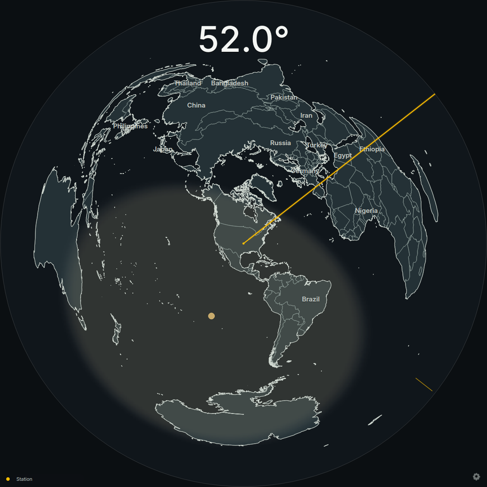
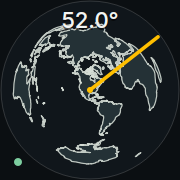
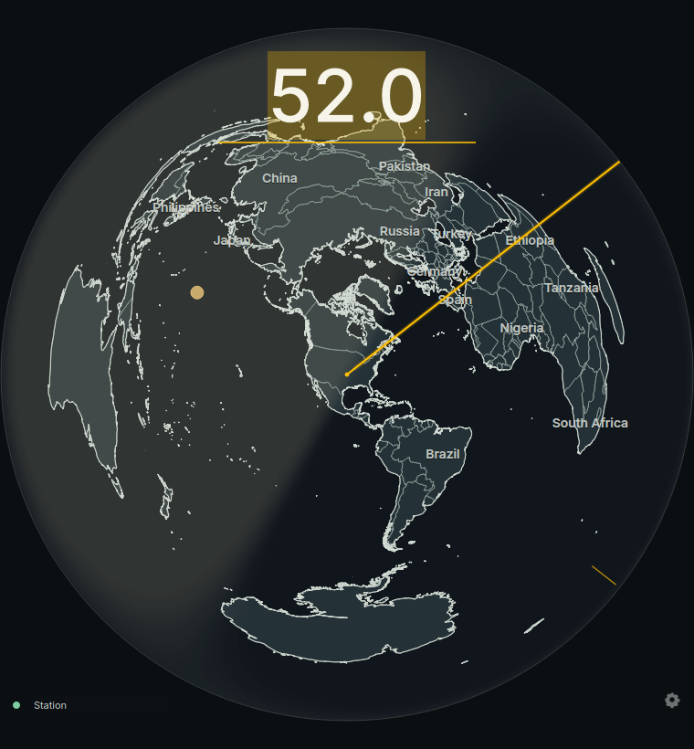
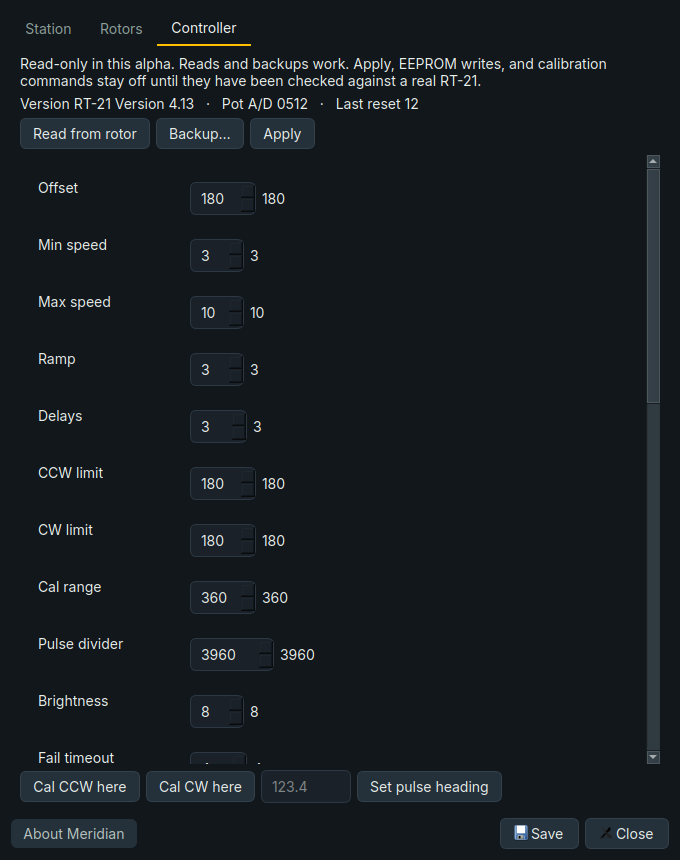

# Meridian

Meridian is a small, fast rotator controller for the Green Heron RT-21 (Traditional and Deluxe / RT-21D, which speak the same protocol). It is aimed at one job: show where the antenna is pointed, and turn it.

The window is the azimuthal map. The heading is a number over the globe. Click the number to type a heading, or click the map to turn to that bearing. Esc or Space stops the rotor. A gear in the corner opens settings. Nothing else sits on the map.

Written for Andrew, K5PO. Licensed under GPL-3.0-or-later. The 0.1.0-alpha3 build keeps controller writes off and, by default, records raw rotor traffic in `%APPDATA%\Meridian\logs` (a `Record rotor traffic` checkbox turns that off). Each log line is flushed immediately. Rebuild with `-DMERIDIAN_ALPHA_READONLY=OFF` to allow Apply.

Every TCP connect is limited to 3 seconds. If the rotor closed the session or stopped answering, the next background try waits 20 seconds, then backs off up to 5 minutes. If the host does not answer, tries are 15 seconds apart for the first 2 minutes, then use that same backoff. A click, a typed heading, opening the app, or leaving settings tries immediately. A goto is never resent on a later reconnect. Idle polls are every 30 seconds (30–60 in Settings). Settings has one map switch, **Show sun & day/night**, on by default. The sun and the day/night tint are not clickable. See [docs/ROADMAP.md](docs/ROADMAP.md) for what comes after this alpha.



| Tiny | Medium | Editing a heading |
| --- | --- | --- |
|  |  |  |

The 180 px window drops country borders and labels, thickens the beam, and hides the gear until the pointer is over the window. Larger windows use the 1:50m Natural Earth set, with borders and the names of the larger countries. Lines are drawn in device-independent pixels, so a Retina or 5K display gets a sharp stroke instead of a scaled-up picture. [`docs/screenshots/main-2x.png`](docs/screenshots/main-2x.png) is a 760×760 window rendered at 2× (1520×1520 pixels).

## Build

Qt 6 (Widgets, Network, SerialPort, Svg), a C++17 compiler, and CMake 3.16+.

```bash
cmake -S . -B build -DCMAKE_BUILD_TYPE=Release
cmake --build build --parallel
ctest --test-dir build --output-on-failure
./build/meridian
```

Ubuntu packages: `qt6-base-dev`, `qt6-serialport-dev`, `qt6-svg-dev`, `cmake`, `ninja-build`, `g++`.

On Windows, install Qt 6 with MinGW or MSVC and add its `bin` directory to `PATH` before configuring. On macOS, the Qt online installer or `brew install qt` both work; pass `-DCMAKE_PREFIX_PATH` to the Qt prefix if CMake does not find it. A tag `v*` builds a Windows zip and installer and a macOS `.dmg` in GitHub Actions. Those artifacts are unsigned.

Linux is a first-class build. The release workflows only package Windows and macOS.

## Use

On first launch the home location is grid **EM26** (Bella Vista, Arkansas) and the rotor is an RT-21 at **192.168.1.106:6555**, which is the usual Green Heron serial-TCP port. Settings are stored with `QSettings` under the organization `K5PO` and the application `Meridian`.

- Click the globe to turn to that bearing. The orange line is where the rotor is now. A short tick on the rim is the heading it is moving toward.
- Click the heading number. Enter, or clicking elsewhere, sends it. Esc cancels the edit.
- Esc or Space, while not editing, sends `;` and stops the rotor.
- The gear opens settings. On a tiny window it stays hidden until the pointer is over the map. Ctrl+, opens settings too.
- A rotor menu appears only when more than one rotor is saved.
- The dot is the link: green connected, amber moving or connecting, red failed. The tooltip has the reason, including a refused TCP connection.

The home location accepts any of:

- Maidenhead, 4, 6, or 8 characters (`EM26`, `EM26UL`)
- A US ZIP or ZIP+4. Centroids come from the Census Bureau 2020 ZCTA gazetteer. ZCTAs leave out some PO-box-only codes.
- Coordinates: `36.47, -94.23`, `36.47N 94.23W`, `N36.47 W94.23`, `36°28'12"N 94°13'48"W`, `36 28 12 N 94 13 48 W`, `36°28.2'N 94°13.8'W`

The resolved latitude, longitude, and grid are shown under the field before you save.

Each rotor is an RT-21 on TCP (`host` and port) or on a serial / USB-serial port. The port list refreshes while the dialog is open. Baud is 4800 by default, or 9600. The frame is 8N1.

### Without a rotor

```bash
./build/meridian-mock --tcp 6555 --heading 52 --speed 20
./build/meridian --connect tcp://127.0.0.1:6555
```

`meridian --mock` starts that mock itself and points the session at it, without rewriting saved settings. `meridian-mock --pty` also prints a pseudo-terminal path on Linux and macOS.

### Controller setup

The Controller tab reads the documented queries (`R11;`, `R01;`, `R41;`, and `RA1;` through `RZ1;`) and can write the numeric EEPROM fields from Appendix F. Apply writes a JSON backup first and asks before sending. Factory reset, the bootloader, and the network-module commands are not sent. The on-wire shape of an EEPROM write is documented as inferred in [docs/RT21_PROTOCOL.md](docs/RT21_PROTOCOL.md) and has not been tried on hardware.



## Tests

`tst_core` covers grids, every coordinate form above, ZIP centroids, click bearing, the 359.9° clamp, the azimuthal projection, country hit-testing, and protocol framing. `tst_driver` connects to the mock over TCP and, on Unix, over a pty, and checks that a second TCP client is refused. `tst_globe` clicks the map and edits the heading.

## Credits

- Click-to-bearing and the Maidenhead conversion are derived from [QLog](https://github.com/foldynl/QLog) `ui/RotatorWidget` and `data/Gridsquare` (GPL-3.0-or-later). Copyright Thomas Gatzweiler 2020 and Ladislav Foldyna 2021–2026. Meridian does not use QLog’s logger, profiles, or database.
- Coastlines and country borders are [Natural Earth](https://www.naturalearthdata.com/) 1:110m and 1:50m land and admin-0 countries, public domain.
- ZIP centroids are the [US Census Bureau 2020 Gazetteer](https://www2.census.gov/geo/docs/maps-data/data/gazetteer/2020_Gazetteer/2020_Gaz_zcta_national.zip) ZCTA file, public domain.
- Inter is © The Inter Project Authors, SIL Open Font License 1.1. See `third_party/inter/OFL.txt`.
- RT-21 behavior follows the Green Heron RT-21 manual (Appendix F) and the Version 4 addendum, plus the Hamlib RT-21 backend (`rotators/rotorez/rotorez.c`, model 405) for the tenths goto frame. Green Heron Engineering is not involved with this project.

## Not yet tried on a real RT-21

The driver, mock, and tests agree with each other. They have not been run against a controller on the bench. In particular:

- Whether the serial-TCP port needs the CR in `AP1xxx.y\r;`, or accepts the command without it.
- Whether a real unit’s EEPROM read comes back as a bare integer. If it doesn’t, the field stays read-only and the raw text is shown.
- The `WD1180;` style write (location, digit `1`, decimal value, semicolon). Apply will not send it until you confirm, and it saves a backup first.
- Rotors set up for more than 360° of travel. Meridian clamps to 359.9°, the same limit Hamlib publishes for the RT-21.
- What the controller does if another program already holds the TCP port, beyond the refused connection the mock produces.
